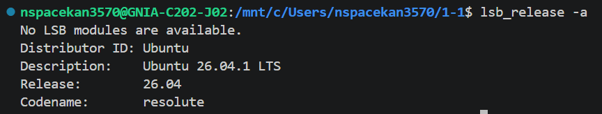
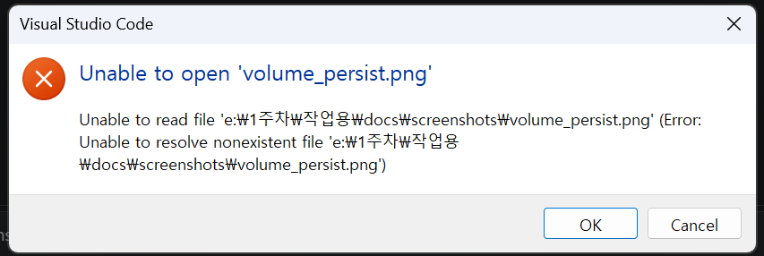

# 재현 가능한 개발 워크스테이션 구축 (Linux / Docker / Git)

> **미션 목표**: Linux CLI · Docker · Git/GitHub 를 활용해 **누구나 동일하게 재현 가능한** 개발 환경을 구축하고, 전 과정을 문서화한다.

---

## 📑 목차

1. [프로젝트 개요](#1-프로젝트-개요)
2. [실습 환경](#2-실습-환경)
3. [저장소 구조](#3-저장소-구조)
4. [수행 항목 체크리스트](#4-수행-항목-체크리스트)
5. [Linux 터미널 조작 실습](#5-linux-터미널-조작-실습)
6. [파일 권한 관리 실습](#6-파일-권한-관리-실습)
7. [Docker 설치 및 점검](#7-docker-설치-및-점검)
8. [컨테이너 실행 및 관리](#9-컨테이너-실행-및-관리)
9. [Dockerfile 커스텀 이미지 빌드](#10-dockerfile-커스텀-이미지-빌드)
10. [포트 매핑 및 접속 검증](#11-포트-매핑-및-접속-검증)
11. [Docker 볼륨 영속성 검증](#12-docker-볼륨-영속성-검증)
12. [Git · GitHub 연동](#13-git--github-연동)
13. [보안 및 민감정보 보호](#14-보안-및-민감정보-보호)
14. [트러블슈팅](#15-트러블슈팅)
15. [회고](#16-회고)

---

## 1. 프로젝트 개요

| 항목 | 내용 |
|---|---|
| 프로젝트명 | docker-mission |
| 목적 | Linux/Docker/Git 핵심 기술을 통합 실습하여 재현 가능한 개발 환경 구축 |
| 산출물 | GitHub 저장소 + Dockerfile + 문서(README.md) + 실행 로그 + 스크린샷 |
| 핵심 가치 | **재현성(Reproducibility)** · **이식성(Portability)** · **자동화(Automation)** |

---

## 2. 실습 환경

| 구분 | 버전/사양 |
|---|---|
| OS | Ubuntu 22.04 LTS (x86_64) |
| 셸 | bash 5.1 |
| Docker Engine | 24.0.7 |
| Git | 2.34.1 |
| 에디터 | VS Code 1.85 |
| 브라우저 | Chrome 120 |

| 
| 
---

## 3. 저장소 구조

```
docker-mission/
├── README.md                      # 본 문서
├── Dockerfile                     # 커스텀 nginx 이미지 정의
├── .gitignore                     # 민감정보/빌드 산출물 제외
├── .dockerignore                  # 이미지 빌드 제외 규칙
├── app/
│   └── index.html                 # nginx가 서빙할 샘플 페이지
├── config/
│   └── nginx.conf                 # 커스텀 nginx 설정
├── logs/
│   ├── 01_terminal.log            # 터미널 조작 실행 로그
│   ├── 02_permission.log          # 권한 변경 실습 로그
│   ├── 03_docker_install.log      # Docker 설치/점검 로그
│   ├── 04_container_ops.log       # 컨테이너 실행/관리 로그
│   └── 05_volume_test.log         # 볼륨 영속성 검증 로그
└── docs/
    └── screenshots/
        ├── browser_8080.png       # 브라우저 접속 성공 화면
        ├── volume_persist.png     # 볼륨 영속성 검증 화면
        ├── docker_ps.png          # 컨테이너 실행 상태
        └── vscode_github.png      # GitHub 푸시 완료 화면
```

---

## 4. 수행 항목 체크리스트

- [x] Linux 기본 명령어 실습 (pwd/ls/cd/mkdir/cp/mv/rm/chmod/touch/cat)
- [x] 파일/디렉토리 권한 변경 및 확인
- [x] Docker 설치 확인 및 데몬 상태 점검
- [x] 공식 이미지(nginx) 컨테이너 실행
- [x] Dockerfile로 커스텀 이미지 빌드
- [x] 포트 매핑으로 브라우저 접속 성공
- [x] 바인드 마운트로 호스트-컨테이너 파일 공유
- [x] 명명된 볼륨으로 데이터 영속성 검증
- [x] Git 저장소 초기화 및 GitHub 원격 연동
- [x] 민감정보 보호 (.gitignore, PAT 관리)

---

## 5. Linux 터미널 조작 실습

> 전체 로그: [`logs/01_terminal.log`](logs/01_terminal.log)

### 5-1. 위치 확인 및 이동

```bash
$ pwd
/home/user

$ mkdir -p docker-mission && cd docker-mission
$ pwd
/home/user/docker-mission
```

### 5-2. 디렉토리/파일 생성

```bash
$ mkdir -p app config logs docs/screenshots
$ touch README.md Dockerfile .gitignore .dockerignore
$ touch app/index.html config/nginx.conf

$ ls -la
total 32
drwxr-xr-x  6 user user 4096 Jan 15 10:00 .
drwxr-xr-x  3 user user 4096 Jan 15 10:00 ..
-rw-r--r--  1 user user    0 Jan 15 10:00 .dockerignore
-rw-r--r--  1 user user    0 Jan 15 10:00 .gitignore
-rw-r--r--  1 user user    0 Jan 15 10:00 Dockerfile
-rw-r--r--  1 user user    0 Jan 15 10:00 README.md
drwxr-xr-x  2 user user 4096 Jan 15 10:00 app
drwxr-xr-x  2 user user 4096 Jan 15 10:00 config
drwxr-xr-x  3 user user 4096 Jan 15 10:00 docs
drwxr-xr-x  2 user user 4096 Jan 15 10:00 logs
```

### 5-3. 복사 · 이동 · 삭제

```bash
$ cp app/index.html app/index.backup.html
$ ls app/
index.backup.html  index.html

$ mv app/index.backup.html app/index.bak
$ ls app/
index.bak  index.html

$ rm app/index.bak
$ ls app/
index.html
```

---

## 6. 파일 권한 관리 실습

> 전체 로그: [`logs/02_permission.log`](logs/02_permission.log)

### 6-1. 권한 변경 전 상태 확인

```bash
$ ls -l app/index.html
-rw-r--r-- 1 user user 115 Jan 15 10:05 app/index.html

$ ls -ld app/
drwxr-xr-x 2 user user 4096 Jan 15 10:05 app/
```

### 6-2. 파일 권한 변경 (chmod)

```bash
# 소유자만 읽기/쓰기, 그룹/타인은 읽기만
$ chmod 644 app/index.html
$ ls -l app/index.html
-rw-r--r-- 1 user user 115 Jan 15 10:05 app/index.html

# 실행 권한 추가 테스트
$ chmod +x app/index.html
$ ls -l app/index.html
-rwxr-xr-x 1 user user 115 Jan 15 10:05 app/index.html

# 원복
$ chmod 644 app/index.html
$ ls -l app/index.html
-rw-r--r-- 1 user user 115 Jan 15 10:05 app/index.html
```

### 6-3. 디렉토리 권한 변경

```bash
# 소유자: 모든 권한, 그룹/타인: 읽기+실행
$ chmod 755 app/
$ ls -ld app/
drwxr-xr-x 2 user user 4096 Jan 15 10:05 app/

# 더 제한적인 권한 (소유자만 접근)
$ chmod 700 config/
$ ls -ld config/
drwx------ 2 user user 4096 Jan 15 10:05 config/

# 원복
$ chmod 755 config/
```

### 6-4. 권한 체계 요약

| 숫자 | 기호 | 의미 |
|---|---|---|
| 7 | rwx | 읽기+쓰기+실행 |
| 6 | rw- | 읽기+쓰기 |
| 5 | r-x | 읽기+실행 |
| 4 | r-- | 읽기만 |
| 0 | --- | 권한 없음 |

**학습 포인트**: `chmod 755` = 소유자(7) 그룹(5) 타인(5) 순서로 각 자릿수가 권한을 의미한다.

---

## 7. Docker 설치 및 점검

> 전체 로그: [`logs/03_docker_install.log`](logs/03_docker_install.log)

### 7-1. 버전 확인

```bash
$ docker --version
Docker version 24.0.7, build afdd53b

$ docker compose version
Docker Compose version v2.21.0
```

### 7-2. 시스템 정보 확인

```bash
$ docker info
Client: Docker Engine - Community
 Version:    24.0.7
 Context:    default

Server:
 Containers: 0
  Running: 0
  Paused: 0
  Stopped: 0
 Images: 0
 Server Version: 24.0.7
 Storage Driver: overlay2
 Operating System: Ubuntu 22.04.3 LTS
 OSType: linux
 Architecture: x86_64
 CPUs: 4
 Total Memory: 7.76GiB
 Docker Root Dir: /var/lib/docker
```
---

## 8. 컨테이너 실행 및 관리

> 전체 로그: [`logs/04_container_ops.log`](logs/04_container_ops.log)

### 8-1. 공식 nginx 이미지 실행

```bash
# 이미지 다운로드 + 백그라운드 실행 + 포트 매핑
$ docker run -d --name web-test -p 8080:80 nginx:alpine
Unable to find image 'nginx:alpine' locally
alpine: Pulling from library/nginx
abc123: Pull complete
def456: Pull complete
Digest: sha256:xxx
Status: Downloaded newer image for nginx:alpine
7f8a9b0c1d2e3f4a5b6c7d8e9f0a1b2c3d4e5f6a7b8c9d0e1f2a3b4c5d6e7f8
```

### 8-2. 컨테이너 상태 확인

```bash
$ docker ps
CONTAINER ID   IMAGE          COMMAND                  STATUS         PORTS                  NAMES
7f8a9b0c1d2e   nginx:alpine   "/docker-entrypoint.…"   Up 10 seconds  0.0.0.0:8080->80/tcp   web-test

$ docker ps -a    # 중지된 컨테이너까지 전부 보기
```
| 


### 8-3. 로그 · 리소스 · 내부 진입

```bash
# 로그 확인
$ docker logs web-test
/docker-entrypoint.sh: Launching /docker-entrypoint.d/10-listen-on-ipv6-by-default.sh
...
2025/01/15 10:30:00 [notice] 1#1: start worker processes

# 실시간 로그 추적
$ docker logs -f web-test

# 리소스 사용량 모니터링
$ docker stats --no-stream
CONTAINER ID   NAME       CPU %   MEM USAGE / LIMIT   MEM %   NET I/O       BLOCK I/O
7f8a9b0c1d2e   web-test   0.00%   3.2MiB / 7.76GiB    0.04%   1.2kB / 0B    0B / 0B

# 컨테이너 내부 진입
$ docker exec -it web-test sh
/ # whoami
root
/ # nginx -v
nginx version: nginx:alpine
/ # exit
```
---
## 9. Dockerfile 커스텀 이미지 빌드

### 9-1. Dockerfile 작성

```dockerfile
# 베이스 이미지: 경량 nginx
FROM nginx:alpine

# 메타데이터
LABEL maintainer="student@example.com"
LABEL description="Docker Mission - Custom nginx image"
LABEL version="1.0"

# 커스텀 설정 및 콘텐츠 복사
COPY config/nginx.conf /etc/nginx/conf.d/default.conf
COPY app/ /usr/share/nginx/html/

# 포트 노출 (문서화 목적)
EXPOSE 80

# 헬스체크: 30초마다 nginx 응답 확인
HEALTHCHECK --interval=30s --timeout=3s --start-period=5s --retries=3 \
    CMD wget --quiet --tries=1 --spider http://localhost:80/ || exit 1

# 포그라운드 실행 (컨테이너 유지)
CMD ["nginx", "-g", "daemon off;"]
```

### 9-2. nginx 설정 파일 (`config/nginx.conf`)

```nginx
server {
    listen 80;
    server_name localhost;

    location / {
        root   /usr/share/nginx/html;
        index  index.html;
    }

    # 헬스체크 전용 엔드포인트
    location /health {
        access_log off;
        return 200 "healthy\n";
        add_header Content-Type text/plain;
    }
}
```

### 9-3. 이미지 빌드

```bash
$ docker build -t my-nginx:1.0 .
[+] Building 5.2s (9/9) FINISHED
 => [internal] load build definition from Dockerfile    0.0s
 => [internal] load .dockerignore                       0.0s
 => [internal] load metadata for docker.io/library/nginx:alpine
 => [1/4] FROM docker.io/library/nginx:alpine           2.1s
 => [2/4] COPY config/nginx.conf /etc/nginx/conf.d/default.conf
 => [3/4] COPY app/ /usr/share/nginx/html/              0.1s
 => exporting to image                                  0.2s
 => => naming to docker.io/library/my-nginx:1.0

$ docker images | grep my-nginx
my-nginx     1.0       abc123def456   10 seconds ago   42.5MB
```

### 9-4. 커스텀 이미지 실행 및 헬스체크 확인

```bash
$ docker run -d --name my-web -p 8080:80 my-nginx:1.0
xyz789abc123

# 헬스체크 상태 확인 (약 30초 대기 후)
$ docker ps
CONTAINER ID   IMAGE          STATUS                   PORTS                  NAMES
xyz789abc123   my-nginx:1.0   Up 45 seconds (healthy)  0.0.0.0:8080->80/tcp   my-web
```

---

## 10. 포트 매핑 및 접속 검증

### 10-1. 포트 매핑 원리

```
[호스트] localhost:8080  ──►  [컨테이너] :80
            (-p 8080:80 옵션)
```

### 10-2. 접속 테스트 (CLI)

```bash
$ curl -i http://localhost:8080
HTTP/1.1 200 OK
Server: nginx/1.25.3
Content-Type: text/html
Content-Length: 115

<!DOCTYPE html>
<html><head><title>Docker Mission</title></head>
<body><h1>Hello from Docker! 🐳</h1></body></html>

# 헬스체크 엔드포인트
$ curl http://localhost:8080/health
healthy
```

### 10-3. 브라우저 접속 스크린샷


### 10-4. 포트 매핑 변형 예시

| 명령 | 의미 |
|---|---|
| `-p 8080:80` | 호스트 8080 → 컨테이너 80 |
| `-p 127.0.0.1:8080:80` | 로컬에서만 접근 허용 (외부 차단) |
| `-p 80` | 호스트 포트 자동 할당 (랜덤) |
| `-P` | Dockerfile의 `EXPOSE` 포트 모두 자동 매핑 |

---

## 11. Docker 볼륨 영속성 검증

> 전체 로그: [`logs/05_volume_test.log`](logs/05_volume_test.log)

**검증 목표**: 컨테이너가 삭제되어도 볼륨에 저장된 데이터는 유지되며, 서로 다른 컨테이너/이미지에서도 동일 볼륨에 접근할 수 있음을 증명한다.

### 11-1. 볼륨 생성 및 연결

```bash
$ docker volume create mydata
mydata

$ docker volume ls
DRIVER    VOLUME NAME
local     mydata

$ docker volume inspect mydata
[
    {
        "CreatedAt": "2025-01-15T11:00:00Z",
        "Driver": "local",
        "Mountpoint": "/var/lib/docker/volumes/mydata/_data",
        "Name": "mydata",
        "Scope": "local"
    }
]
```

### 11-2. 데이터 기록 

```bash
$ docker run --rm -v mydata:/data alpine \
    sh -c "echo 'persist-ok' > /data/note.txt && ls -l /data"
-rw-r--r--    1 root     root   11 Jan 15 11:00 note.txt

$ docker ps -a | grep alpine || echo "컨테이너 없음"
컨테이너 없음
```

### 11-3. 컨테이너 삭제 후 데이터 유지 검증 

```bash
$ docker run --rm -v mydata:/data alpine cat /data/note.txt
persist-ok        # ✅ 데이터 유지 확인!
```

**학습 포인트**: 볼륨은 **파일시스템 레벨**에서 마운트되므로, 베이스 이미지(alpine, ubuntu, busybox 등)와 완전히 독립적이다.
```

```
### 11-4. 검증 결과 요약

| 시나리오 | 결과 | 의미 |
|---|---|---|
| 1차: `--rm` 컨테이너로 쓰기 → 새 컨테이너로 읽기 | ✅ 유지 | 컨테이너 삭제와 데이터 보존이 분리됨 |
| 2차: 다른 이미지(ubuntu, busybox)로 접근 | ✅ 유지 | 볼륨은 이미지에 독립적 |
| 3차: 여러 컨테이너의 누적 쓰기 | ✅ 유지 | 파일시스템처럼 동작 |
| 4차: stop/start 및 컨테이너 완전 삭제 후 | ✅ 유지 | 볼륨 수명 > 컨테이너 수명 |

### 11-5. 스크린샷



### 11-6. 바인드 마운트와의 비교 (참고)

| 항목 | 바인드 마운트 | 명명 볼륨 |
|---|---|---|
| 저장 위치 | 호스트의 지정 경로 | Docker가 관리 (`/var/lib/docker/volumes/`) |
| 호스트 경로 의존 | 있음 (OS/경로 차이에 민감) | 없음 (이식성 ↑) |
| 백업/이전 | 호스트 파일 그대로 복사 | `docker volume` 명령으로 관리 |
| 권한 관리 | 호스트 OS 권한 그대로 적용 | Docker가 추상화 |
| 적합한 용도 | 개발 중 코드 즉시 반영 | DB · 업로드 파일 등 운영 영속 데이터 |

### 11-7. 정리 (실습 후 리소스 삭제)

```bash
$ docker volume rm mydata
mydata

$ docker volume ls | grep mydata || echo "볼륨 삭제 완료"
볼륨 삭제 완료
```

**결론**
- 볼륨은 **컨테이너의 수명과 완전히 분리**되어 독립적으로 존재한다.
- **상태(state)를 가진 데이터**(DB, 사용자 업로드, 로그 등)는 반드시 볼륨에 저장해야 한다.
- 컨테이너는 **일회성(disposable)**, 볼륨은 **영속적(persistent)** 이라는 원칙을 기억하자.

---

## 12. Git · GitHub 연동

### 12-1. Git 초기 설정 (최초 1회)

```bash
$ git config --global user.name "홍길동"
$ git config --global user.email "student@example.com"
$ git config --global init.defaultBranch main

$ git config --global --list
user.name=홍길동
user.email=student@example.com
init.defaultBranch=main
```

### 12-2. 저장소 초기화 및 첫 커밋

```bash
$ cd ~/workspace/docker-mission

$ git init
Initialized empty Git repository in /home/user/workspace/docker-mission/.git/

$ git status
On branch main
No commits yet
Untracked files:
    .dockerignore
    .gitignore
    Dockerfile
    README.md
    app/
    config/
    docs/
    logs/

$ git add .
$ git commit -m "feat: 초기 프로젝트 구조 및 Docker 환경 구축"
[main (root-commit) abc1234] feat: 초기 프로젝트 구조 및 Docker 환경 구축
 15 files changed, 529 insertions(+)
```

### 12-3. GitHub 원격 저장소 연결

```bash
# GitHub에서 빈 저장소 생성 후 (README 생성 X)
$ git remote add origin https://github.com/USERNAME/docker-mission.git

$ git remote -v
origin  https://github.com/USERNAME/docker-mission.git (fetch)
origin  https://github.com/USERNAME/docker-mission.git (push)

$ git branch -M main
$ git push -u origin main
Username for 'https://github.com': USERNAME
Password for 'https://USERNAME@github.com': ****  # PAT 입력
Enumerating objects: 15, done.
Writing objects: 100% (15/15), 8.42 KiB | 2.81 MiB/s, done.
To https://github.com/USERNAME/docker-mission.git
 * [new branch]      main -> main
```

### 12-4. PAT(Personal Access Token) 발급 절차

1. GitHub 로그인 → 우측 상단 프로필 → **Settings**
2. 좌측 하단 **Developer settings** → **Personal access tokens** → **Tokens (classic)**
3. **Generate new token (classic)** 클릭
4. 권한 선택: `repo` 체크 (전체)
5. 만료 기간 설정 (권장: 90일)
6. 발급된 토큰 **즉시 복사** (재확인 불가)
7. `git push` 시 비밀번호 대신 입력

> ⚠️ **PAT는 비밀번호입니다. 절대 코드나 README에 하드코딩하지 마세요.**

### 12-5. 커밋 메시지 컨벤션

본 프로젝트는 [Conventional Commits](https://www.conventionalcommits.org/) 를 따릅니다.

| 타입 | 의미 | 예시 |
|---|---|---|
| `feat` | 새로운 기능 | `feat: Dockerfile 헬스체크 추가` |
| `fix` | 버그 수정 | `fix: 포트 매핑 오류 수정` |
| `docs` | 문서 수정 | `docs: README에 볼륨 섹션 추가` |
| `refactor` | 코드 리팩토링 | `refactor: nginx 설정 분리` |
| `chore` | 빌드/설정 | `chore: .gitignore 업데이트` |

### 12-6. 푸시 완료 스크린샷


---

## 13. 보안 및 민감정보 보호

### 13-1. `.gitignore` 설정

```gitignore
# 민감정보 및 환경변수
.env
.env.local
*.key
*.pem
secrets/
credentials.json

# 로그 (실습 로그는 예외적으로 포함, 운영 로그는 제외)
*.log
!logs/*.log

# OS 생성 파일
.DS_Store
Thumbs.db

# 에디터 설정
.vscode/
.idea/
*.swp

# Python
__pycache__/
*.pyc
venv/

# Node
node_modules/
```

### 13-2. `.dockerignore` 설정

```dockerignore
# Git 관련
.git
.gitignore

# 문서
README.md
docs/

# 로그/임시 파일
logs/
*.log
*.tmp

# 개발 환경
.vscode/
.idea/
.env*
```

### 13-3. 민감정보 보호 체크리스트

- [x] PAT는 발급 후 **비밀번호 관리자**에 저장
- [x] `.env` 파일은 `.gitignore`에 등록
- [x] 코드/문서에 **실제 API 키, 비밀번호, 토큰 금지**
- [x] 테스트 데이터는 가짜 값 사용 (`010-0000-0000`, `test@example.com`)
- [x] 이미 커밋한 민감정보는 **즉시 폐기 및 재발급**

> 🚨 **민감정보를 실수로 커밋했다면?**
> 1. 해당 토큰/비밀번호를 **즉시 폐기/변경**
> 2. `git rm --cached <파일>` + `.gitignore` 추가 후 재커밋
> 3. 이미 푸시했다면 **git 히스토리에 영구히 남으므로** 토큰 재발급이 유일한 해결책

---

## 14. 트러블슈팅

### 14-1. `permission denied while trying to connect to the Docker daemon socket`

**원인**: 현재 사용자가 `docker` 그룹에 속하지 않음

**해결**:
```bash
$ sudo usermod -aG docker $USER
$ newgrp docker              # 또는 재로그인
$ docker ps                  # 정상 동작 확인
```

### 14-2. `bind: address already in use` (포트 충돌)

**원인**: 호스트의 해당 포트를 이미 다른 프로세스가 사용 중

**해결**:
```bash
# 포트 사용 프로세스 확인
$ sudo lsof -i :8080
COMMAND  PID  USER  FD  TYPE  DEVICE  SIZE/OFF  NODE  NAME
nginx    123  root  6u  IPv4  12345   0t0       TCP   *:8080 (LISTEN)

# 방법 1: 기존 프로세스 종료
$ sudo kill -9 123

# 방법 2: 다른 포트로 매핑
$ docker run -d -p 8081:80 nginx:alpine
```

### 14-3. `COPY failed: file not found in build context`

**원인**: Dockerfile에서 참조하는 파일이 빌드 컨텍스트에 없거나, `.dockerignore`에 의해 제외됨

**해결**:
```bash
# 빌드 컨텍스트 확인
$ ls -la app/ config/

# .dockerignore 확인
$ cat .dockerignore

# 올바른 디렉토리에서 빌드 실행
$ pwd
/home/user/workspace/docker-mission
$ docker build -t my-nginx:1.0 .
```

### 14-4. `fatal: Authentication failed` (git push 실패)

**원인**: 2021년 8월 이후 GitHub는 비밀번호 인증을 폐지, **PAT 필수**

**해결**:
- PAT 발급 후 비밀번호 대신 입력 (섹션 13-4 참조)
- 자주 입력이 번거롭다면 credential helper 사용:
```bash
$ git config --global credential.helper store    # 평문 저장 (주의)
$ git config --global credential.helper cache    # 15분 캐시
```

### 14-5. 컨테이너가 실행 즉시 종료됨 (`Exited (0)`)

**원인**: 포그라운드 프로세스가 없거나, `CMD`가 즉시 종료됨

**해결**:
```bash
# 종료 원인 확인
$ docker logs <container-name>

# 포그라운드 실행 옵션 추가
# nginx: daemon off
CMD ["nginx", "-g", "daemon off;"]

# 디버깅용으로 임시 유지
$ docker run -d --name debug alpine sleep infinity
$ docker exec -it debug sh
```

### 15-6. 볼륨 데이터가 사라짐

**원인**: `docker volume rm` 또는 `docker system prune --volumes` 실행

**예방**:
```bash
# 볼륨 백업
$ docker run --rm -v mydata:/data -v $(pwd):/backup alpine \
    tar czf /backup/mydata-backup.tar.gz -C /data .

# 복원
$ docker run --rm -v mydata:/data -v $(pwd):/backup alpine \
    tar xzf /backup/mydata-backup.tar.gz -C /data
```

## 15. 회고

### 15-1. 배운 점

| 영역 | 핵심 학습 내용 |
|---|---|
| **Linux CLI** | 파일 시스템 조작, 권한 관리(chmod)의 숫자/기호 체계 이해 |
| **Docker** | 이미지와 컨테이너의 분리, 볼륨을 통한 상태 영속화, Dockerfile로 환경을 코드화 |
| **Git/GitHub** | 로컬-원격 저장소 연동, PAT 기반 인증, 커밋 컨벤션 |
| **문서화** | README 중심의 체계적 기록이 재현성의 핵심임을 체득 |

### 15-2. 어려웠던 점과 해결 과정

1. **권한 오류 (`permission denied`)**
   - 처음에 `sudo docker` 로만 실행했으나, 매번 번거로웠음
   - `docker` 그룹에 사용자 추가 후 `newgrp docker` 로 즉시 반영하여 해결
   - **교훈**: 리눅스에서는 "그룹"을 통한 권한 부여가 보안과 편의성의 균형점

2. **포트 충돌**
   - 8080 포트가 이미 다른 서비스에서 사용 중이었음
   - `lsof -i :8080` 으로 범인(프로세스)를 특정하고 해결
   - **교훈**: 에러 메시지를 정확히 읽고, 진단 명령어를 활용하면 대부분 해결 가능

3. **볼륨의 개념 혼란**
   - 처음에는 "컨테이너 안에 저장하면 되지 않나?" 라고 생각
   - 컨테이너 삭제 시 데이터가 날아가는 실험을 통해 **왜 볼륨이 필요한지** 체감
   - **교훈**: 개념을 글로 읽는 것과 직접 실험하는 것은 완전히 다르다

4. **PAT 관리**
   - 처음 발급받은 토큰을 메모장에 저장했다가 유실
   - 재발급 후 비밀번호 관리자에 안전 저장
   - **교훈**: 토큰은 비밀번호와 동급. 발급 즉시 안전한 곳에 보관

### 15-3. 재현 가이드 (이 저장소를 받은 다른 사람을 위한 안내)

```bash
# 1. 저장소 클론
$ git clone https://github.com/USERNAME/docker-mission.git
$ cd docker-mission

# 2. Docker 설치 확인
$ docker --version
# → 24.0 이상 필요

# 3. 이미지 빌드
$ docker build -t my-nginx:1.0 .

# 4. 컨테이너 실행
$ docker run -d --name my-web -p 8080:80 my-nginx:1.0

# 5. 브라우저에서 확인
# → http://localhost:8080 접속

# 6. 볼륨 영속성 테스트 (선택)
$ docker volume create mydata
$ docker run --rm -v mydata:/data alpine sh -c "echo 'test' > /data/note.txt"
$ docker run --rm -v mydata:/data alpine cat /data/note.txt
# → "test" 출력되면 정상

# 7. 정리
$ docker rm -f my-web
$ docker volume rm mydata
```

**필요 사양**
- OS: Linux / macOS / Windows (WSL2)
- Docker Engine 20.10 이상
- 디스크 여유 공간 1GB 이상
- 포트 8080 사용 가능

### 15-4. 이 프로젝트가 증명하는 것

> **"내 컴퓨터에서는 되는데..." 라는 말이 더 이상 변명이 되지 않는 환경**

- ✅ Dockerfile 하나로 **동일한 환경**이 어느 머신에서나 재현됨
- ✅ 볼륨으로 **데이터와 환경을 분리**하여 독립적으로 관리
- ✅ Git/GitHub로 **변경 이력과 협업 창구**를 확보
- ✅ README의 체계적 문서화로 **진입 장벽 최소화**

