# 🎮 개발 환경 세팅 완벽 가이드
> 처음 시작하는 개발자를 위한 친절한 설명서

---

## 📚 목차

```
1.  문제 상황
2.  전체 흐름 한눈에 보기
3.  핵심 도구 3가지
4.  터미널 (리눅스 CLI) — 마법 주문책
5.  Docker — 마법 도시락통
6.  Git / GitHub — 코드 세이브 버튼
7.  세 도구를 함께 쓰면?
8.  자주 하는 실수 & 해결법
9.  미션 체크리스트
10. 다음 단계로 나아가기
```
---

## 📌 프로젝트 개요
💡 "개발을 처음 시작하는 사람도 쉽게 따라할 수 있는
    개발 환경 세팅 완벽 가이드"

❌ 기존의 문제:
   - 개발 환경 세팅 문서는 너무 어렵고 딱딱하다
   - 전문 용어가 많아서 초보자가 이해하기 어렵다
   - 실습 없이 이론만 나열되어 있다
   - "내 컴퓨터에서는 되는데?" 문제가 반복된다

✅ 이 가이드의 해결책:
   - 비유와 그림으로 쉽게 설명한다
   - 단계별 실습 코드를 제공한다
   - 자주 하는 실수와 해결법을 함께 담는다
   - 누구나 똑같은 환경에서 실행할 수 있게 안내한다


 ## 수행 항목 체크리스트

- [x] Linux 기본 명령어 실습 (pwd/ls/cd/mkdir/rm)
- [x] 파일/디렉토리 확인
- [x] Docker 설치 확인 및 데몬 상태 점검
- [x] 공식 이미지(nginx) 컨테이너 실행
- [x] Dockerfile로 커스텀 이미지 빌드
- [x] 포트 매핑으로 브라우저 접속 성공
- [x] 바인드 마운트로 호스트-컨테이너 파일 공유
- [x] 명명된 볼륨으로 데이터 영속성 검증
- [x] Git 저장소 초기화 및 GitHub 원격 연동


## 1. 😤 이런 경험 있으신가요?

```
👨‍💻 나  : "코드 완성했어! 실행해봐!"
👩‍💻 친구 : "어? 나는 오류 나는데?"
👨‍💻 나  : "내 컴퓨터에서는 되는데...?"
```

> 💡 이 문제를 해결하는 것이 이 가이드의 목표예요!

---

## 2. 🗺️ 전체 흐름 한눈에 보기

```
[내 컴퓨터] ──터미널──▶ [폴더 정리]
                              │
                              ▼
                         [Docker 설치]
                              │
                              ▼
                    [프로그램을 컨테이너에 담기]
                              │
                              ▼
                    [어디서나 똑같이 실행! 🎉]
                              │
                              ▼
                    [Git으로 팀원과 공유하기 👫]
```
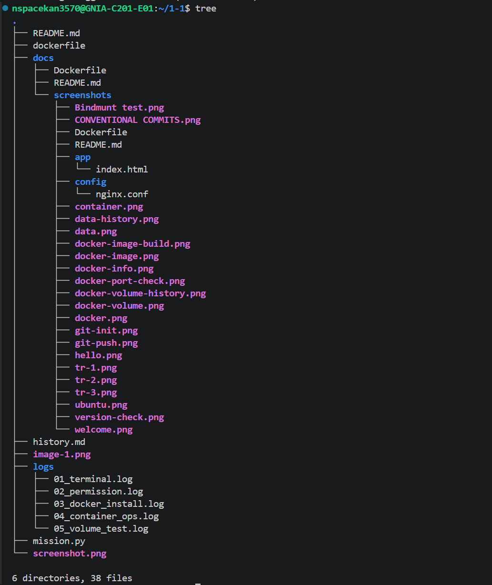
---

## 3. 🧰 핵심 도구 3가지

| 번호 | 도구 | 한 줄 설명 | 비유 |
|------|------|----------|------|
| 4절 | **터미널** | 글자로 컴퓨터에게 명령하기 | 마법 주문책 📖 |
| 5절 | **Docker** | 어디서나 똑같이 실행되는 환경 만들기 | 도시락통 🍱 |
| 6절 | **Git/GitHub** | 코드 저장하고 팀원과 공유하기 | 세이브 버튼 💾 |

---

## 4. 📖 터미널 (리눅스 CLI) — 마법 주문책

### 4-1. 터미널이 뭔가요?

마우스로 클릭클릭 하는 대신,  
**글자로 컴퓨터에게 명령을 내리는 방법**이에요!

> 🎮 비유: 리모컨 버튼 대신 **직접 말로 TV를 조종**하는 것!

### 4-2. 자주 쓰는 명령어

| 명령어 | 하는 일 | 예시 |
|--------|--------|------|
| `ls` | 파일 목록 보기 | `ls` |
| `cd` | 폴더 이동하기 | `cd 바탕화면` |
| `mkdir` | 새 폴더 만들기 | `mkdir 내폴더` |
| `pwd` | 현재 위치 확인 | `pwd` |
| `rm` | 파일/폴더 삭제 | `rm 파일이름` |

### 4-3. 직접 해봐요! 🖐️

```bash
# 1. 현재 위치 확인하기
pwd

# 2. 폴더 목록 보기
ls

# 3. 새 폴더 만들기
mkdir my-project

# 4. 만든 폴더로 이동하기
cd my-project

# 5. 잘 이동했는지 확인
pwd
```

> ✅ 결과: 화면에 경로가 뜨면 성공이에요!

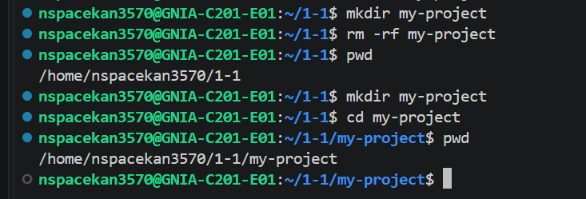


### 4-4. 파일 권한 변경 (chmod)

```bash
# 소유자만 읽기/쓰기, 그룹/타인은 읽기만
$ chmod 644 app/index.html
$ ls -l app/index.html
-rw-r--r-- 1 user user 115 Jan 15 10:05 app/index.html

# 실행 권한 추가 테스트
$ chmod +x app/index.html
$ ls -l app/index.html
-rwxr-xr-x 1 user user 115 Jan 15 10:05 app/index.html

# 원복
$ chmod 644 app/index.html
$ ls -l app/index.html
-rw-r--r-- 1 user user 115 Jan 15 10:05 app/index.html
```

### 4-5. 디렉토리 권한 변경

```bash
# 소유자: 모든 권한, 그룹/타인: 읽기+실행
$ chmod 755 app/
$ ls -ld app/
drwxr-xr-x 2 user user 4096 Jan 15 10:05 app/

# 더 제한적인 권한 (소유자만 접근)
$ chmod 700 config/
$ ls -ld config/
drwx------ 2 user user 4096 Jan 15 10:05 config/

# 원복
$ chmod 755 config/
```

### 4-6. 권한 체계 요약

| 숫자 | 기호 | 의미 |
|---|---|---|
| 7 | rwx | 읽기+쓰기+실행 |
| 6 | rw- | 읽기+쓰기 |
| 5 | r-x | 읽기+실행 |
| 4 | r-- | 읽기만 |
| 0 | --- | 권한 없음 |

---

## 5. 🍱 Docker — 마법 도시락통

### 5-1. Docker가 뭔가요?

```
일반 방법:
  내 컴퓨터 ✅  →  친구 컴퓨터 ❌  →  회사 서버 ❌

Docker 사용:
  내 컴퓨터 ✅  →  친구 컴퓨터 ✅  →  회사 서버 ✅
```

> 🍱 비유: 도시락통에 음식을 담으면  
> **어디서 열어도 똑같은 음식**이 나오는 것처럼!

### 5-2. 핵심 개념 3가지

```
📦 이미지 (Image)
   = 도시락 레시피
   → 어떻게 만들지 적어놓은 설명서

🍱 컨테이너 (Container)
   = 실제 도시락통
   → 레시피대로 만들어진 실제 실행 환경

📄 Dockerfile
   = 레시피를 적는 종이
   → 이미지를 어떻게 만들지 코드로 작성
```

### 5-3. Docker 핵심 명령어

| 명령어 | 하는 일 |
|--------|--------|
| `docker pull 이미지명` | 레시피 다운받기 |
| `docker run 이미지명` | 도시락통 만들어서 실행 |
| `docker ps` | 실행 중인 컨테이너 목록 보기 |
| `docker stop 컨테이너명` | 컨테이너 멈추기 |
| `docker rm 컨테이너명` | 컨테이너 삭제하기 |

### 5-4. 직접 해봐요! 🖐️

```bash
# 1. Docker 설치 확인
docker --version


# 2. 테스트용 컨테이너 실행 (hello-world)
docker run hello-world

# 3. 웹 서버 실행해보기 (nginx)
docker run -d -p 8080:80 nginx
#           │   └─────── 내 컴퓨터 8080포트 → 컨테이너 80포트 연결
#           └─────────── 백그라운드에서 실행

# 4. 실행 중인 컨테이너 확인
docker ps

# 5. 브라우저에서 확인
# 👉 http://localhost:8080 접속해보세요!
```
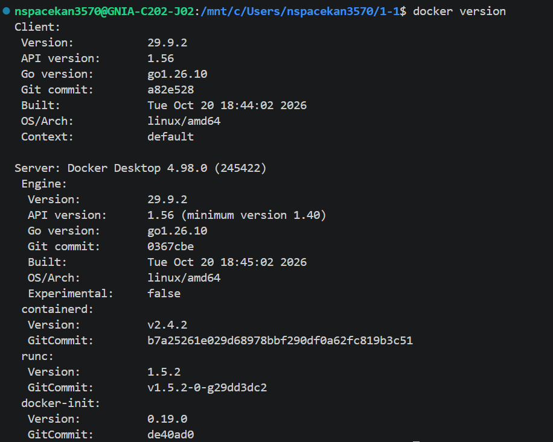
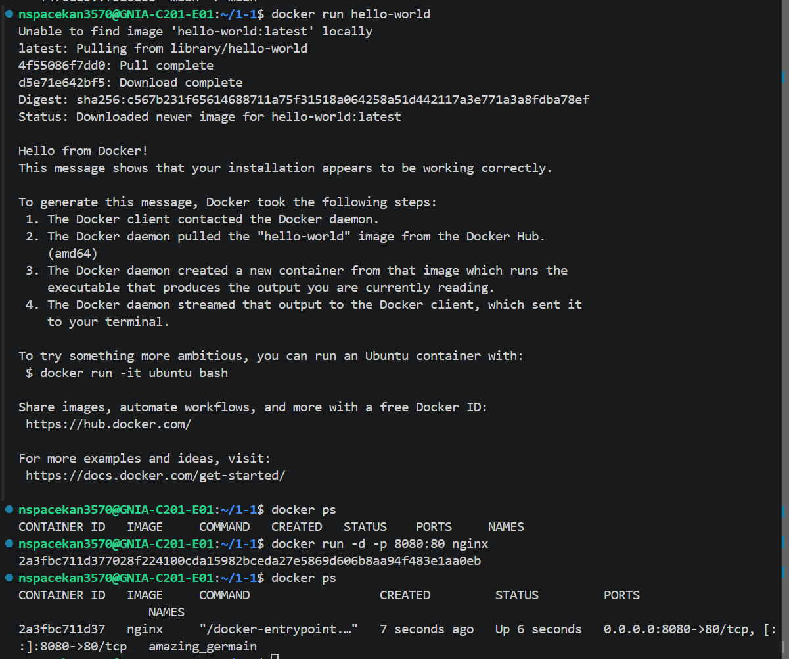
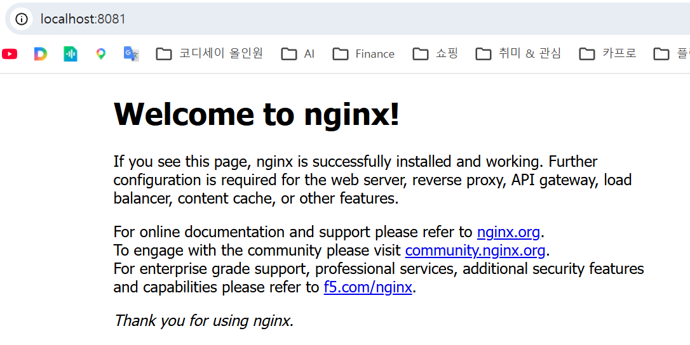


> ✅ 브라우저에 "Welcome to nginx!" 가 뜨면 성공이에요!

### 5-5. Dockerfile 만들어보기

```dockerfile
# Dockerfile

# 1. 베이스 이미지 선택 (기본 도시락통 종류 고르기)
FROM nginx:latest

# 2. 내 파일을 컨테이너 안에 복사하기
COPY index.html /usr/share/nginx/html/index.html

# 3. 열어둘 포트 번호 알려주기
EXPOSE 80
```

```bash
# Dockerfile로 이미지 만들기
docker build -t my-web-server .

# 만든 이미지로 컨테이너 실행
docker run -d -p 8080:80 my-web-server
```

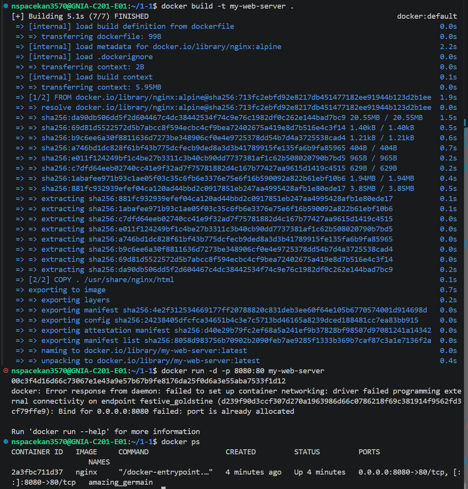

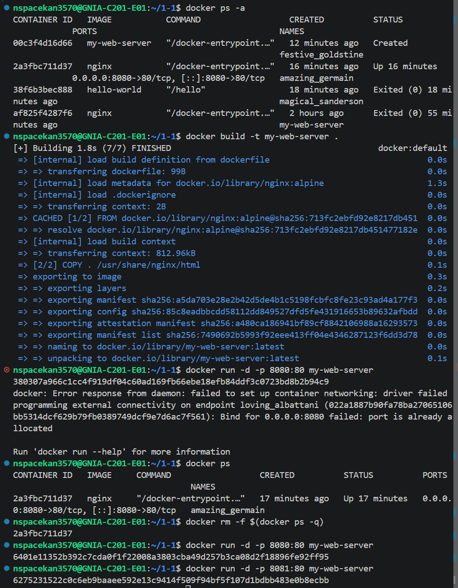


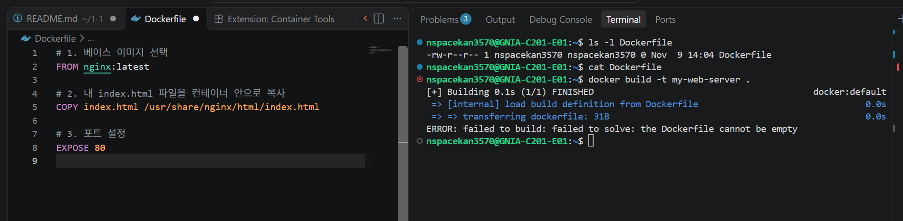


# Docker Hello
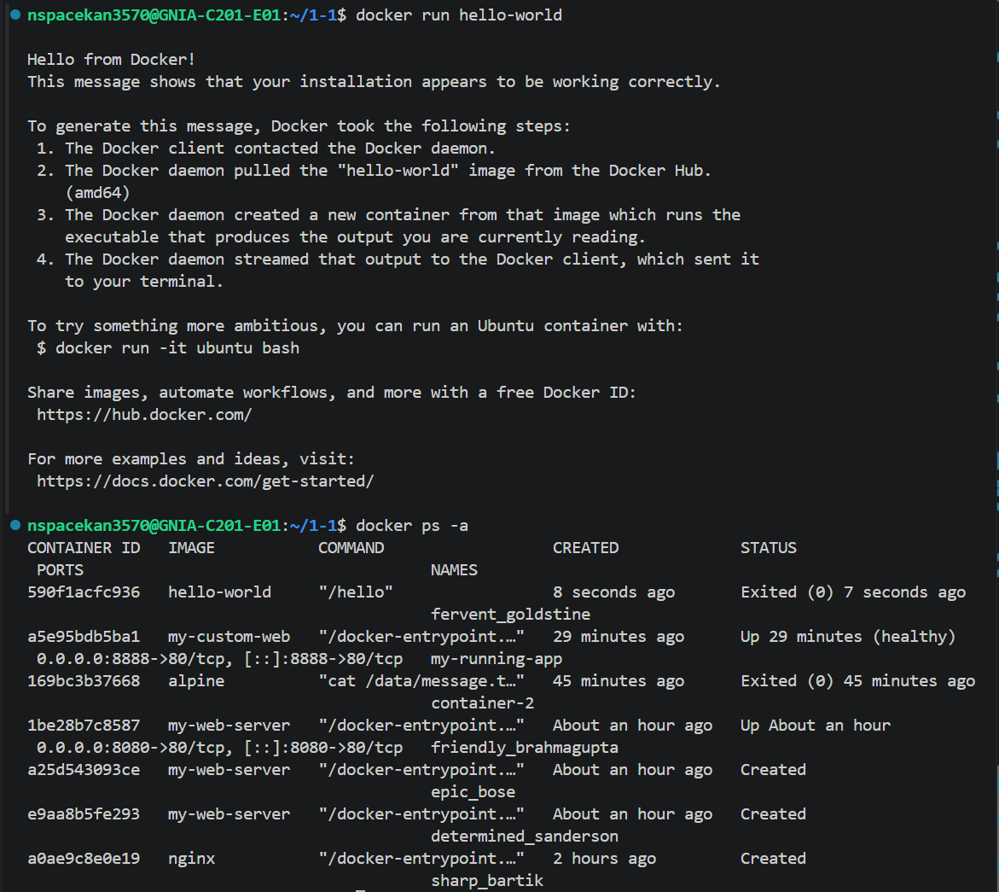


# 커스텀이미지 제작

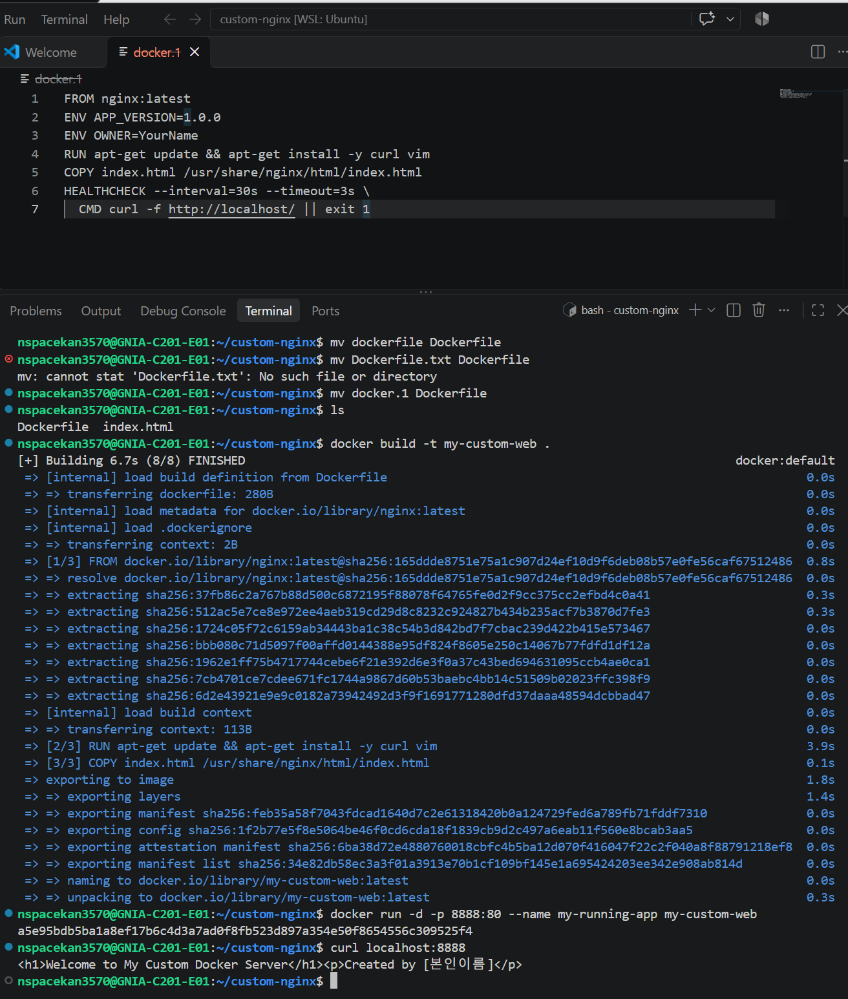

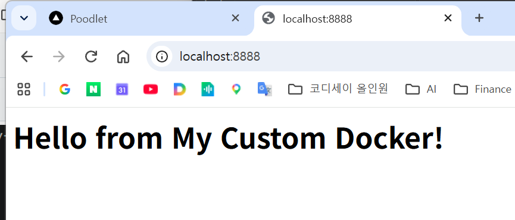


### 5-6. 포트(Port)가 뭔가요?

```
🏠 컨테이너 = 아파트 건물
🚪 포트      = 각 집의 호수

-p 8080:80 의 의미:
  내 컴퓨터 8080번 문 → 컨테이너 80번 문으로 연결!

마치 "101호로 오는 손님을 201호로 안내해줘" 같은 것!
```

### 5-7. 바인드 마운트 vs 볼륨

```
🔗 바인드 마운트 (Bind Mount)
   = 내 폴더와 컨테이너 폴더를 연결하기
   → 내가 파일 수정하면 컨테이너에도 바로 반영!

   docker run -v /내폴더:/컨테이너폴더 이미지명

💾 볼륨 (Volume)
   = Docker가 관리하는 별도 저장공간
   → 컨테이너가 삭제돼도 데이터는 살아있음!

   docker run -v 볼륨이름:/컨테이너폴더 이미지명
```

| 구분 | 바인드 마운트 | 볼륨 |
|------|------------|------|
| 관리 주체 | 내가 직접 | Docker가 자동 |
| 데이터 위치 | 내가 지정한 폴더 | Docker 내부 |
| 컨테이너 삭제 시 | 파일 유지 ✅ | 데이터 유지 ✅ |
| 주로 쓰는 상황 | 개발 중 코드 수정 | 데이터베이스 저장 |

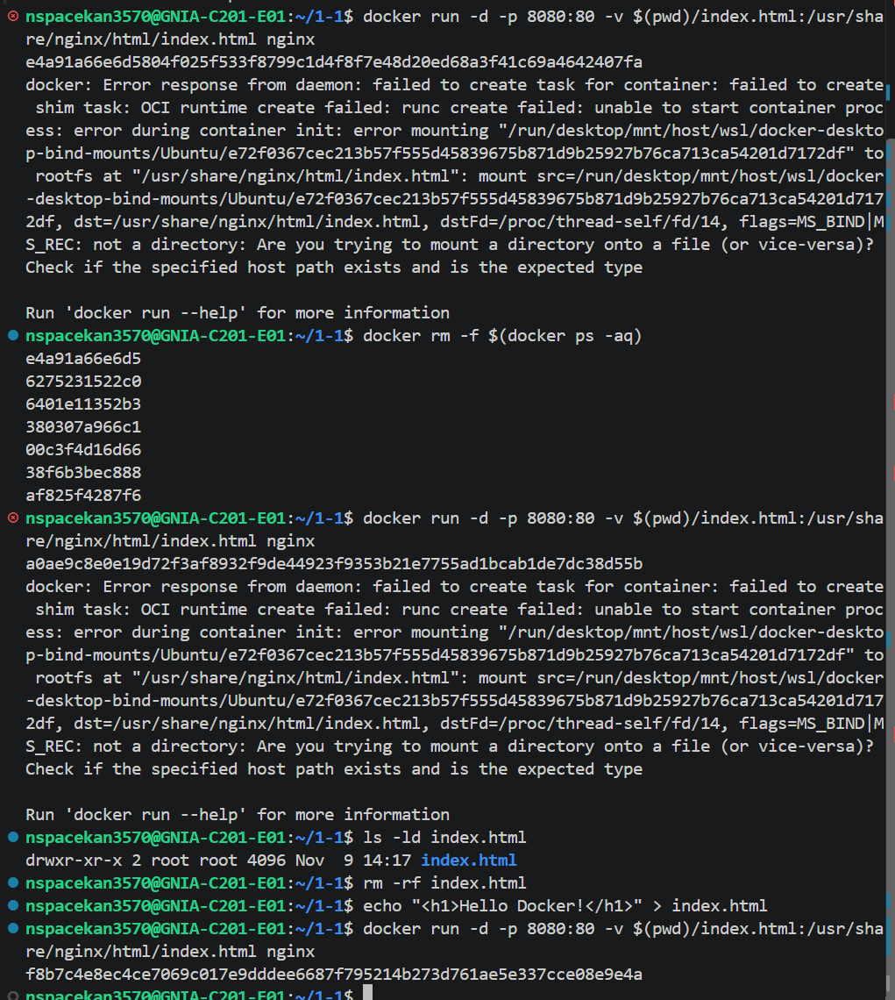

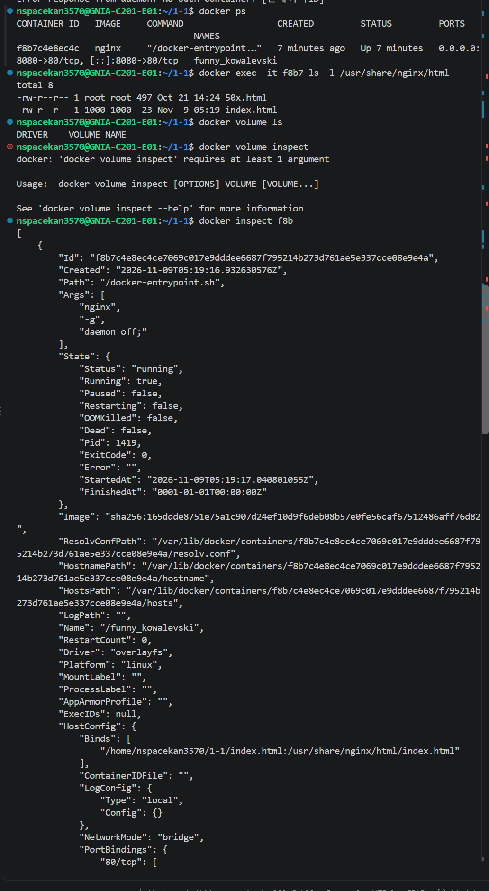

Docker 볼륨 영속성 검증

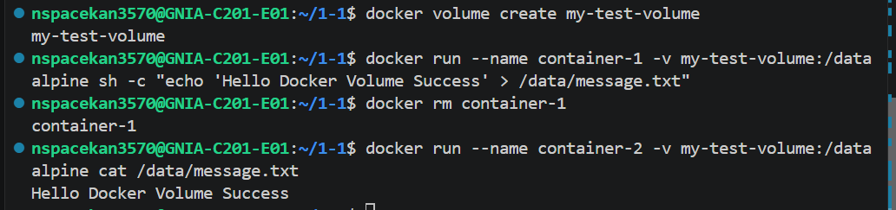

**결론**
- 볼륨은 **컨테이너의 수명과 완전히 분리**되어 독립적으로 존재한다.
- **상태(state)를 가진 데이터**(DB, 사용자 업로드, 로그 등)는 반드시 볼륨에 저장해야 한다.
- 컨테이너는 **일회성(disposable)**, 볼륨은 **영속적(persistent)** 이라는 원칙을 기억하자.

---

## 6. 💾 Git / GitHub — 코드 세이브 버튼

### 6-1. Git이 뭔가요?

> 🎮 비유: 게임의 **세이브 기능**이에요!

```
코드 작성 → 저장(commit) → 실수 → 이전으로 되돌리기(reset)
                                          ↑
                                    세이브 덕분에 가능!
```

### 6-2. GitHub가 뭔가요?

> ☁️ 비유: 세이브 파일을 **클라우드에 올려두는 것**!

```
Git    = 내 컴퓨터에서 세이브하기
GitHub = 인터넷에 세이브 파일 올려두기
         → 팀원과 공유 가능! 👫
```

### 6-3. Git 핵심 명령어

| 명령어 | 하는 일 | 게임으로 비유 |
|--------|--------|------------|
| `git init` | Git 시작하기 | 새 게임 시작 |
| `git add .` | 저장할 파일 고르기 | 세이브할 항목 체크 |
| `git commit -m "메시지"` | 저장하기 | 세이브 완료! |
| `git push` | GitHub에 올리기 | 클라우드 백업 |
| `git pull` | GitHub에서 받아오기 | 클라우드에서 불러오기 |
| `git status` | 현재 상태 확인 | 현재 진행상황 보기 |

### 6-4. 직접 해봐요! 🖐️

```bash
# 1. Git 설치 확인
git --version

# 2. 내 정보 등록 (처음 한 번만!)
git config --global user.name "내이름"
git config --global user.email "내이메일@example.com"

# 3. 프로젝트 폴더에서 Git 시작
git init

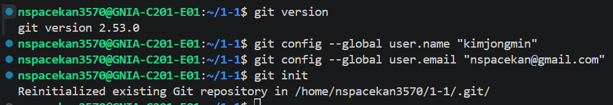


# 4. 파일 만들고 저장해보기
echo "Hello, Git!" > hello.txt

# 5. 저장할 파일 선택
git add hello.txt

# 6. 세이브하기 (커밋)
git commit -m "첫 번째 파일 추가"

# 7. 저장 기록 확인
git log --oneline
```

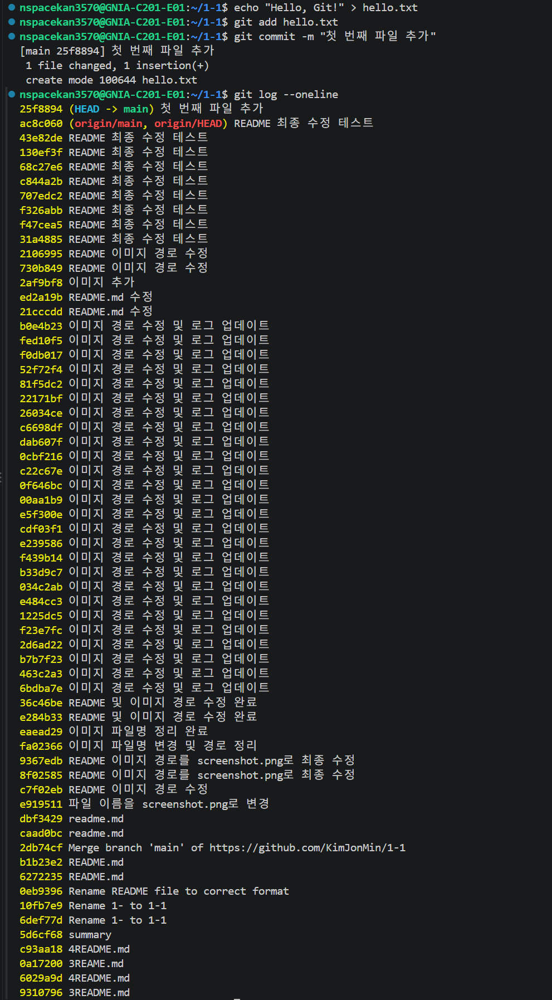

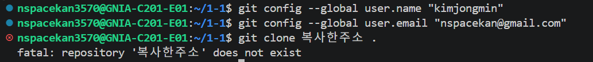

> ✅ 커밋 기록이 뜨면 성공이에요!

---

## 7. 🔄 세 도구를 함께 쓰면?

```
📝 코드 작성
    │
    ▼
🖥️  터미널로 폴더 정리 & 명령 실행
    │
    ▼
🍱 Docker로 컨테이너에 담아서 실행
    │
    ▼
💾 Git으로 코드 저장
    │
    ▼
☁️  GitHub에 올려서 팀원과 공유
    │
    ▼
🎉 팀원 누구나 똑같은 환경에서 실행!
```

---

## 8. ❓ 보안 및 민감정보 보호

```gitignore
# 민감정보 및 환경변수
.env
.env.local
*.key
*.pem
secrets/
credentials.json

# 로그 (실습 로그는 예외적으로 포함, 운영 로그는 제외)
*.log
!logs/*.log

# OS 생성 파일
.DS_Store
Thumbs.db

# 에디터 설정
.vscode/
.idea/
*.swp

# Python
__pycache__/
*.pyc
venv/

# Node
node_modules/
```

---

### 9-1. 학습 로드맵

```
현재 ✅ 개발 환경 세팅 완료!
         │
         ▼
🔧 STEP 1. 리눅스 트러블슈팅
           (오류 메시지 읽기, 로그 확인, 프로세스 관리)
         │
         ▼
🐳 STEP 2. Docker 심화
           (docker-compose, 멀티스테이지 빌드, 네트워크)
         │
         ▼
🌿 STEP 3. Git 심화
           (branch, merge, pull request, conflict 해결)
         │
         ▼
⚙️  STEP 4. CI/CD 파이프라인
           (GitHub Actions, 자동 테스트, 자동 배포)
         │
         ▼
☁️  STEP 5. 클라우드 배포 & 운영
           (AWS / GCP / Azure 에 서비스 올리기)
         │
         ▼
🎉 실제 서비스 운영 가능한 개발자!
```

---

### 9-2. 추천 학습 순서

| 단계 | 주제 | 핵심 키워드 | 예상 기간 |
|------|------|-----------|---------|
| 1단계 | 리눅스 기초 | 파일 권한, 프로세스, 네트워크 | 1~2주 |
| 2단계 | Docker 심화 | docker-compose, 멀티스테이지 | 2~3주 |
| 3단계 | Git 심화 | branch, merge, pull request | 1~2주 |
| 4단계 | CI/CD | GitHub Actions, 자동 배포 | 2~3주 |
| 5단계 | 클라우드 | AWS / GCP / Azure | 3~4주 |

> 💡 **팁:** 한 단계씩 차근차근 해요!
> 한꺼번에 다 배우려고 하면 지쳐요 😅

---


#### 📺 추천 학습 방법

```
1. 공식 문서 읽기
      ↓
2. 무료 실습 사이트에서 직접 해보기
      ↓
3. 작은 프로젝트에 적용해보기
      ↓
4. 오류가 나면 → 검색 → 해결 → 기록하기
      ↓
5. 반복! 반복! 반복! 💪
```

---

### 9-4. 최종 정리

#### 핵심 도구 요약

| 도구 | 한 줄 설명 | 비유 | 핵심 명령어 |
|------|----------|------|-----------|
| **터미널** | 글자로 컴퓨터에게 명령하기 | 마법 주문책 📖 | `ls` `cd` `mkdir` |
| **Docker** | 어디서나 똑같이 실행되는 환경 | 도시락통 🍱 | `run` `build` `ps` |
| **Git** | 코드 저장하고 팀원과 공유 | 세이브 버튼 💾 | `add` `commit` `push` |

#### 이것만 기억하세요! ⭐

```
✔️  터미널  = 글자로 컴퓨터에게 명령하는 도구
✔️  Docker  = 어디서나 똑같이 실행되는 환경을 만드는 도구
✔️  Git     = 코드를 저장하고 팀원과 공유하는 도구

🎯 최종 목표 한 문장:
"누가, 어디서, 언제 실행해도 똑같이 동작하는 환경 만들기!"
```

## 10. 회고

### 10-1. 배운 점

| 영역 | 핵심 학습 내용 |
|---|---|
| **Linux CLI** | 파일 시스템 조작, 권한 관리(chmod)의 숫자/기호 체계 이해 |
| **Docker** | 이미지와 컨테이너의 분리, 볼륨을 통한 상태 영속화, Dockerfile로 환경을 코드화 |
| **Git/GitHub** | 로컬-원격 저장소 연동, PAT 기반 인증, 커밋 컨벤션 |
| **문서화** | README 중심의 체계적 기록이 재현성의 핵심임을 체득 |

### 10-2. 어려웠던 점과 해결 과정

1. **권한 오류 (`permission denied`)**
   - 처음에 `sudo docker` 로만 실행했으나, 매번 번거로웠음
   - `docker` 그룹에 사용자 추가 후 `newgrp docker` 로 즉시 반영하여 해결
   - **교훈**: 리눅스에서는 "그룹"을 통한 권한 부여가 보안과 편의성의 균형점

2. **포트 충돌**
   - 8080 포트가 이미 다른 서비스에서 사용 중이었음
   - `lsof -i :8080` 으로 범인(프로세스)를 특정하고 해결
   - **교훈**: 에러 메시지를 정확히 읽고, 진단 명령어를 활용하면 대부분 해결 가능

3. **볼륨의 개념 혼란**
   - 처음에는 "컨테이너 안에 저장하면 되지 않나?" 라고 생각
   - 컨테이너 삭제 시 데이터가 날아가는 실험을 통해 **왜 볼륨이 필요한지** 체감
   - **교훈**: 개념을 글로 읽는 것과 직접 실험하는 것은 완전히 다르다

4. **PAT 관리**
   - 처음 발급받은 토큰을 메모장에 저장했다가 유실
   - 재발급 후 비밀번호 관리자에 안전 저장
   - **교훈**: 토큰은 비밀번호와 동급. 발급 즉시 안전한 곳에 보관


### 10-3. 이 프로젝트가 증명하는 것

> **"내 컴퓨터에서는 되는데..." 라는 말이 더 이상 변명이 되지 않는 환경**

- ✅ Dockerfile 하나로 **동일한 환경**이 어느 머신에서나 재현됨
- ✅ 볼륨으로 **데이터와 환경을 분리**하여 독립적으로 관리
- ✅ Git/GitHub로 **변경 이력과 협업 창구**를 확보
- ✅ README의 체계적 문서화로 **진입 장벽 최소화**


